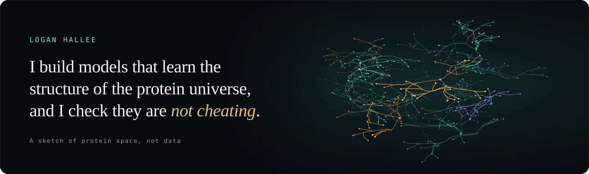

I am the cofounder and CSO of [Synthyra](https://synthyra.com/) and a postdoctoral research fellow in the [Gleghorn Lab](https://www.gleghornlab.com/) at the University of Delaware, where I work on protein language models, interaction prediction, and sequence design. A protein model learns whatever separates the labels in its data, which is sometimes biology and often a shortcut, so a good share of my work is building the splits and controls that expose the shortcut before anyone trusts the score.

**[lhallee.github.io](https://lhallee.github.io/)** has the research, the papers, and the longer story.

## Got spare GPU hours or tokens?

I have somewhere to put them. Two of my projects are open problems with a scoreboard, and both were built so that a stranger, or a stranger's coding agent, can start exactly where the last attempt stopped. Both also keep a public list of what failed and why, so nobody has to pay for the same dead end twice.

| Project | Spend | The problem |
|---|---|---|
| [SpeedrunningPLMs](https://github.com/Synthyra/SpeedrunningPLMs) | GPU&nbsp;hours | How good a protein masked language model can one GPU train against a fixed clock? The 1 hour record is a test loss of 2.6525, which sits within 0.03 nats of ESM2 8M, and a contribution is a new module or a recorded run. The [ideas list](https://github.com/Synthyra/SpeedrunningPLMs/blob/main/ideas/README.md) says what to try next. |
| [rule30-open](https://github.com/lhallee/rule30-open) | Tokens | The three Rule 30 Prize problems, worked in Lean against the prize's official statements. Have I solved one? No, and neither has anyone else, but 989 headline theorems are proved and 85 negative results are written down with the reason each one failed. The [open work](https://github.com/lhallee/rule30-open/blob/main/CATALOG.md#open-work) lists conjectures to settle and lemmas to prove. |

## Open source

| Library | What it does |
|---|---|
| [FastPLMs](https://github.com/Synthyra/FastPLMs) | ESM2, ESMC, E1, DPLM, and other protein language models behind one Hugging Face `AutoModel` call, each compared against its official source. Its models have been downloaded more than 2.1 million times. |
| [Protify](https://github.com/Synthyra/Protify) | Benchmark and fine-tune protein language models from one command or a GUI with no code required. |
| [DSM](https://github.com/Gleghorn-Lab/DSM) | Diffusion Sequence Models, which put protein representation and design under a single training scheme. |

Models from all of these projects have been downloaded more than 3 million times on Hugging Face.

## Synthyra

Synthyra is the Public Benefit LLC I cofounded in 2024. We are in talks with government, industry, and research organizations about three uses of our models, which are understanding how pathogens work, finding what treats them, and keeping new ones from being made through DNA and protein synthesis services. Those sound like three problems, and they are one, because each comes down to what binds what. That is the question Atlas, our model, answers for any protein from its sequence alone.

- **Understand.** [Host-pathogen prediction](https://synthyra.com/host-pathogen) ranks the contacts between a pathogen's proteins and the host's, so a laboratory knows what to test first.
- **Treat.** Atlas predicts which proteins a small molecule binds, and the [Andes hantavirus demo](https://synthyra.com/demos/andes-hantavirus) scores three viral proteins against every drug the FDA has approved. Its top two candidates are covered by filed provisional patent applications that name Jason Gleghorn and me as the inventors.
- **Prevent.** [Biosecurity screening](https://synthyra.com/biosecurity) reads what a DNA or protein order is and what it would do, where list matching lets a new or redesigned sequence pass without a second look.

The site has a map of how E. coli reaches into a human cell, and you can [explore it live](https://synthyra.com/demos/artifacts?organism=escherichia-coli-k12).

## Writing

[Minds and Molecules](https://mindsandmolecules.substack.com/) is where I ask the same question one level up, which is what structure is really out there and how a mind would find it. The essays are speculative on purpose and say so.

| Essay | |
|---|---|
| [We Are Moving Too Goddamn Fast](https://mindsandmolecules.substack.com/p/we-are-moving-too-goddamn-fast) | A doomer and an accelerationist walk into a data center. |
| [The Geometry of Mathematical Taste](https://mindsandmolecules.substack.com/p/the-geometry-of-mathematical-taste) | What happens when machines get better at proving theorems than we are at understanding them? |
| [Memes and the Machinery of Selection](https://mindsandmolecules.substack.com/p/memes-and-the-machinery-of-selection) | How patterns persist, replicate, and reshape their own constraints. |
| [How to build Conscious AGI](https://mindsandmolecules.substack.com/p/how-to-build-conscious-agi) | Consciousness as a signal in a network so connected that it runs back into itself. |

## Find me

[Website](https://lhallee.github.io/) · [CV](https://lhallee.github.io/assets/logan_hallee_cv.pdf) · [Hugging Face](https://huggingface.co/lhallee) · [LinkedIn](https://www.linkedin.com/in/logan-hallee/) · [X](https://x.com/Logan_Hallee) · [Substack](https://mindsandmolecules.substack.com/)

Research mail goes to lhallee@udel.edu and company mail to logan@synthyra.com.
